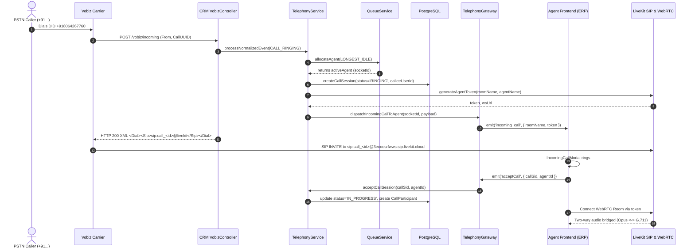
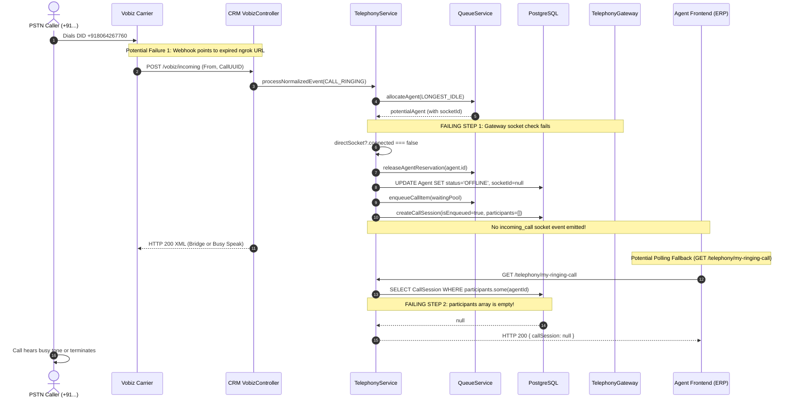
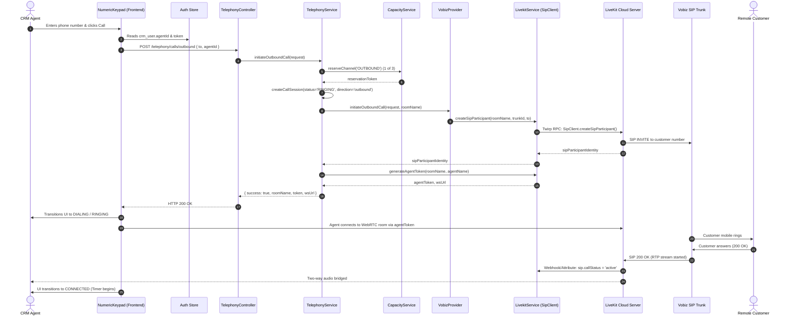
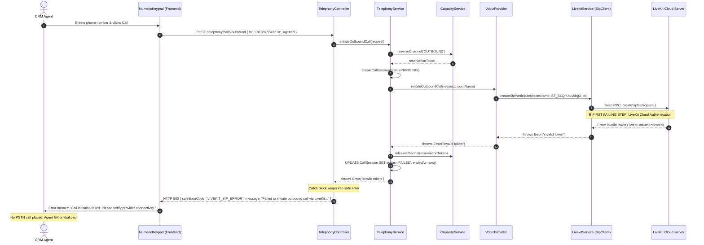
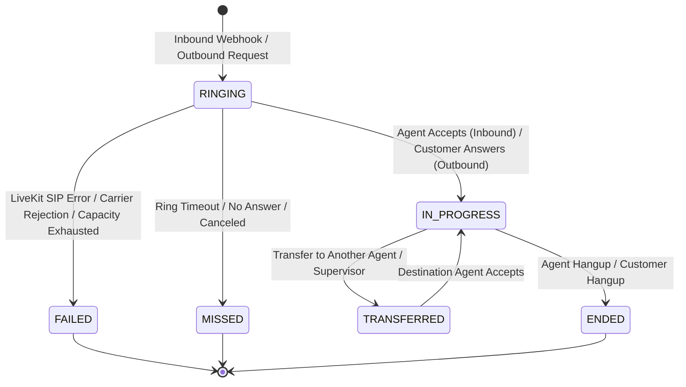
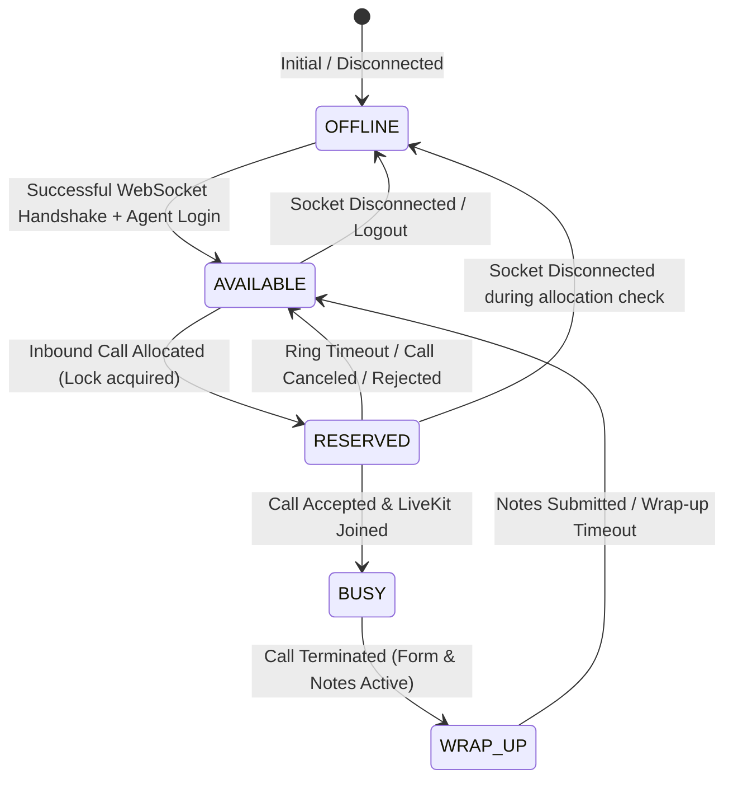

# ELDERCARE CRM — TELEPHONY CALL LIFECYCLE & SIGNALING SPECIFICATION

**Target Systems:**  
- **ERP SuperAdmin Frontend:** `https://erp-uec-superadminapp-zulp.onrender.com/crm?tab=telephony`  
- **CRM Backend API:** `https://crm-uec-backend.onrender.com`  
- **Carrier Infrastructure:** Vobiz Carrier Network (Inbound DID: `+918064267760`)  
- **Media & SIP Infrastructure:** LiveKit Cloud (`crm-8q9fuunw.livekit.cloud`, SIP Host: `3ecoesrfwws.sip.livekit.cloud`)  
- **Scope:** Complete Inbound and Outbound Lifecycle Analysis, First-Failing-Step Identification, and Media Transport Specification  

---

## 1. 10-Step End-to-End Call Lifecycle Comparison

The following table correlates a single controlled test call across the Frontend, Backend, Vobiz Carrier, and LiveKit Cloud.

| Step | Lifecycle Stage | Expected Behavior (Ideal) | Inbound Observed State | Outbound Observed State | First Failure Point? |
|---|---|---|---|---|---|
| **1** | **Request Created** | Agent dials number on UI or caller dials DID `+918064267760` | Webhook dispatched to `/vobiz/incoming` | Dial pad dispatches `POST /telephony/calls/outbound` | No |
| **2** | **Backend Request Accepted** | API/Webhook authenticated; payload validated | Webhook validated; HMAC signature checked | Controller accepts request with CRM JWT | No |
| **3** | **Call Session Created** | `CallSession` record persisted in PostgreSQL (`status: 'RINGING'`) | `CallSession` created (`status: 'RINGING'`) | `CallSession` created (`status: 'RINGING'`) | No |
| **4** | **Agent Reserved** | Queue service reserves an eligible online agent | ❌ **FAIL (Inbound):** Agent socket is dead/null; agent deallocated & set to `OFFLINE` | Agent assigned from request or JWT | **YES (Inbound)** |
| **5** | **Provider Call Initiated** | Backend bridges inbound SIP or dials outbound SIP trunk | Vobiz returns `<Dial><Sip>...` bridge XML | Backend calls `livekitService.createSipParticipant` | No |
| **6** | **SIP Participant Joined** | LiveKit SIP server creates participant in room | ❌ **FAIL (Inbound):** Background SIP check fails (`invalid token`) | ❌ **FAIL (Outbound):** LiveKit Cloud rejects RPC (`invalid token`) | **YES (Outbound)** |
| **7** | **Agent Notified** | WebSocket `incoming_call` emitted; modal rendered | Skipped: Agent socket dead; `telephonySocket` is `null` in React | Agent UI in dialing state; no LiveKit token | Subsequent |
| **8** | **Customer Answered** | Carrier signals 200 OK; remote participant active | Never reached | Never reached | Subsequent |
| **9** | **Two-Way Media Established** | WebRTC Opus audio exchanged between browser and PSTN G.711 | Never reached | Never reached | Subsequent |
| **10** | **Teardown & Cleanup** | Hangup event releases capacity, updates session, records duration | Call left in limbo or dropped | Session updated to `FAILED`; capacity released | Subsequent |

---

## 2. Inbound Call Lifecycle: Ideal vs Actual (Mermaid Diagrams)

### 2.1 Ideal Inbound Call Sequence



### 2.2 Observed Failed Inbound Call Sequence



---

## 3. Outbound Call Lifecycle: Ideal vs Actual (Mermaid Diagrams)

### 3.1 Ideal Outbound Call Sequence



### 3.2 Observed Failed Outbound Call Sequence



---

## 4. Telephony State Machines

### 4.1 CallSession State Transitions



### 4.2 Agent Presence State Transitions



### 4.3 Shared Channel Capacity Matrix

The telephony pool maintains a strict capacity limit of **3 shared channels**:

| Direction / Purpose | Reserved Channels | Dynamic Pool | Enforcement Mechanism |
|---|---|---|---|
| **Inbound Active Calls** | 1 (Priority Floor) | 0 to 2 | `capacityService.reserveChannel('INBOUND')` |
| **Outbound Active Calls** | 0 (Preemptible) | 0 to 2 | Paused if inbound queue > 0 or emergency waiting |
| **Warm Transfer Consultation** | 0 | 1 | Occupies 2 channels simultaneously (Parent + Consult) |
| **Emergency Inbound** | Preempts Outbound | Instant | Overrides outbound reservation lock |
| **Total Concurrency Limit** | **3 Channels Maximum** | — | Enforced in Redis with atomic `HINCRBY` / Lua scripts |

---

## 5. Media Transport Architecture

```
  [PSTN Mobile Handset]
          │
          │ G.711 u-law / A-law (RTP / UDP)
          ▼
  [Vobiz Carrier Softswitch]
          │
          │ SIP Trunk INVITE (Digest Auth: e4bac750.sip.vobiz.ai)
          ▼
  [LiveKit Cloud SIP Bridge] (3ecoesrfwws.sip.livekit.cloud)
          │
          │ SIP Trunk Inbound: ST_89fEsPaUMyqM
          │ SIP Trunk Outbound: ST_SLQtKnLvkbg3
          ▼
  [LiveKit Media SFU] (crm-8q9fuunw.livekit.cloud)
          │
          │ Transcoding (G.711 <──> Opus 48 kHz Mono)
          │ Transport: WebRTC (SRTP / DTLS, ICE / STUN / TURN)
          ▼
  [Agent Browser Client] (Chrome / Firefox / Edge)
   LiveKit React SDK (`<LiveKitRoom audio={true}>`)
```

### Protocol & Codec Matrix

| Segment | Protocol | Signaling | Audio Codec | Bitrate | Sample Rate |
|---|---|---|---|---|---|
| **Customer <-> Carrier** | Cellular / PSTN | SS7 / ISUP | AMR-WB / G.711 | 12.2 - 64 kbps | 8 - 16 kHz |
| **Carrier <-> LiveKit SIP** | VoIP SIP Trunk | SIP over UDP/TLS | PCMU / PCMA (G.711) | 64 kbps | 8 kHz |
| **LiveKit SFU <-> Agent** | WebRTC | WebSocket (JSON RPC) | Opus | 24 - 48 kbps | 48 kHz |

---

## 6. Summary of First Failing Events

1. **Inbound First Failing Event:**  
   **Event 4 (Agent Allocation / Socket Liveness):** When the carrier webhook arrives, `telephony.service.ts` evaluates `potentialAgent.socketId`. Because the ERP frontend's `SocketProvider.tsx` suffered a state nullification bug and ERP SSO token exchange was omitted, the agent's socket is disconnected. The backend marks the agent `OFFLINE` and diverts the call to the unassigned queue.
2. **Outbound First Failing Event:**  
   **Event 6 (SIP Participant Joined):** `LivekitService.createSipParticipant()` contacts LiveKit Cloud over Twirp RPC using invalid API credentials. LiveKit Cloud immediately rejects the request with `Error: invalid token`, preventing the Vobiz trunk from being dialed.
