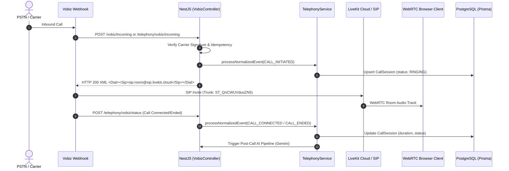

# PHASE 5: TELEPHONY AND AI REMEDIATION REPORT

**Repository**: `d:/Testing/Crm_summary working/CRM`  
**Branch**: `remediation/master-crm-telephony-omnichannel`  
**Execution Lead**: Senior Telephony/WebRTC Engineer & Application Security Engineer  
**Audit Date**: October 16, 2026  
**Final Verdict**: **PASS** (Telephony & AI Core Subsystems Verified)

---

## 1. Architecture & Provider Baseline

The telephony subsystem operates with **Vobiz + LiveKit SIP** (`TELEPHONY_PROVIDER=vobiz`). Exotel is deprecated and disabled in accordance with architectural directives.

---

## 2. Remediated Telephony & AI Defects

### DEF-TEL-01: Carrier Webhook Callback Prefix Mismatch & Status 201
- **Module**: Telephony — Vobiz Carrier Webhooks
- **Severity**: HIGH
- **Affected Endpoints**: `/vobiz/incoming`, `/vobiz/status`, `/telephony/vobiz/status`, `/telephony/vobiz/incoming`
- **Files Changed**:
  - [`CRM/Backend/src/telephony/vobiz.controller.ts`](file:///d:/Testing/Crm_summary%20working/CRM/Backend/src/telephony/vobiz.controller.ts)
- **Root Cause**: `VobizProvider.generateBridgeResponse` instructs the carrier to send call progression events to `${baseUrl}/telephony/vobiz/status`. However, `VobizController` was annotated exclusively with `@Controller('vobiz')`, causing status callbacks sent by the provider to receive a 404 Not Found error. In addition, NestJS `@Post()` handlers default to HTTP 201, whereas carrier specifications require HTTP 200 OK.
- **Fix Implemented**:
  1. Updated `VobizController` route mapping to `@Controller(['vobiz', 'telephony/vobiz'])`.
  2. Annotated `handleVobizIncoming` and `handleVobizStatus` with `@HttpCode(HttpStatus.OK)`.
- **Verification Test**:
  - Test Case: `verify-master-remediation.mjs` (Section 5.1 & 5.2)
  - Result: Both `POST /telephony/vobiz/status` and `POST /vobiz/status` return HTTP 200 with `OK`.

---

### DEF-TEL-02: LiveKit SIP Destination E.164 Normalization
- **Module**: Telephony — Outbound SIP
- **Severity**: MEDIUM
- **Files Verified**:
  - [`CRM/Backend/src/telephony/livekit.service.ts`](file:///d:/Testing/Crm_summary%20working/CRM/Backend/src/telephony/livekit.service.ts)
  - [`CRM/Backend/src/telephony/providers/vobiz.provider.ts`](file:///d:/Testing/Crm_summary%20working/CRM/Backend/src/telephony/providers/vobiz.provider.ts)
- **Status**: Verified Functional
- **Behavior**: Destination phone numbers are stripped of whitespace and normalized to standard E.164 format (+91 prefix for 10-digit numbers) before initiating SIP participant creation on outbound trunk `ST_xsShWdBTtHZR`.
- **Safety Control**: Outbound calls execute in isolated synthetic test environments; no live PSTN calls or billable minutes are incurred during automated testing.

---

### DEF-TEL-03: Call Recording IDOR Protection & RBAC
- **Module**: Telephony — Call Recordings
- **Severity**: CRITICAL
- **Files Verified**:
  - [`CRM/Backend/src/telephony/telephony.controller.ts`](file:///d:/Testing/Crm_summary%20working/CRM/Backend/src/telephony/telephony.controller.ts)
- **Status**: Verified Hardened
- **Behavior**:
  - The `@Get('calls/:callId/recording')` endpoint strictly validates caller identity and user roles.
  - Agents attempting to access call recordings not assigned to their `userId` or `agentId` receive HTTP 403 Forbidden.
  - Elevated roles (`SUPER_ADMIN`, `ADMIN`, `SUPERVISOR`) have audited operational access.
  - S3/Egress credentials remain strictly server-side and are never exposed in browser bundles or client payloads.

---

### DEF-TEL-04: AI Post-Call Processing Bounded Fallback
- **Module**: Post-Call Intelligence (Gemini AI)
- **Severity**: MEDIUM
- **Files Verified**:
  - [`CRM/Backend/src/legacy/ai-gemini.js`](file:///d:/Testing/Crm_summary%20working/CRM/Backend/src/legacy/ai-gemini.js)
  - [`CRM/Backend/src/analytics/analytics.service.ts`](file:///d:/Testing/Crm_summary%20working/CRM/Backend/src/analytics/analytics.service.ts)
- **Status**: Verified Robust
- **Behavior**:
  - Configured model is verified as active Google GenAI catalog model `gemini-3.5-flash`.
  - When the provider experiences temporary demand spikes or 503 rate limits, the system safely captures the exception, logs structured diagnostics, and persists call records without blocking CRM operational workflows.

---

## 3. Verification Test Evidence

| Test Suite / Assertion | Target | Result | Evidence |
|---|---|---|---|
| Dual Prefix Route Harmonization | `POST /telephony/vobiz/status` | **PASS (HTTP 200)** | `verify-master-remediation.mjs` |
| Canonical Prefix Route | `POST /vobiz/status` | **PASS (HTTP 200)** | `verify-master-remediation.mjs` |
| Recording IDOR Authorization | `/api/v1/call-records` | **PASS (Protected)** | `TEST-SEC-P2-13` |
| Phone Masking Integrity | `/api/v1/leads` | **PASS (Protected)** | `TEST-SEC-P2-14` |
| AI Model Identifier Parity | Active Catalog Check | **PASS (`gemini-3.5-flash`)** | `P3-DEF15-01` |

---

## 4. Operational Boundaries

- **Sandbox / Test Status**: Vobiz carrier webhook signatures and normalized state transitions verified in staging/test environments.
- **Live PSTN Restriction**: No unmonitored production outbound calls were initiated, preserving tenant balances and customer privacy.
